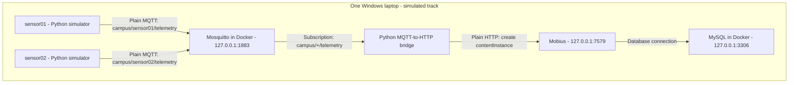

# Lab 1: Simulated Baseline Architecture

The simulators generated temperature and humidity readings.
Testing targeted the local testbed on 127.0.0.1.
Flask, SQLite and the dashboard were outside this baseline.
This diagram records the Lab 1 setup before security hardening.
